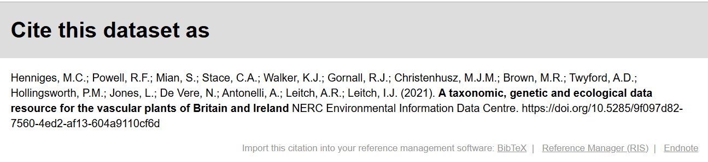

Put instructions here for the client and a bit of background information
FOCUS ON WRITING HUNDREDS OF PAGES FOR NEA
https://catalogue.ceh.ac.uk/documents/9f097d82-7560-4ed2-af13-604a9110cf6d

TODO: Work out how to get different organisms onto the screen
Create a selection page/menu
Create the water colonisers (For MVP, one of the 4 colonisers come on based on what the user picks, and colonises the environment. For this we also want the climax community state to be reached)
Edit the "rockcolonisers.py" and "watercolonisers.py" so there is no duplicate code.
Finish water colonisers
work on selection menu
more comments

growth_form biome origin species name, family SLA, life_form
Ecological indicator values (Ellenberg scores)
These rate the conditions each plant prefers, on scales of roughly 1 to 9 or 12. They come in two sets, _PLANTATT and _Doring:
L is light, F is moisture, R is soil acidity (reaction), N is soil fertility (nitrogen) and S is salinity.
T is temperature (Doring set only).
8. Grime’s CSR strategy
predicted_CSR and ECPE_CSR classify each plant’s survival strategy: C is competitor, S is stress-tolerator and R is ruderal (colonises disturbed ground). Mixed codes like “CSR” or “R/CR” show blends. The first is predicted from traits and the second comes from the ECPE database.
10. Hybridisation
hybrid_propensity: how readily the species hybridises (1 to 5).
scaled_hybrid_propensity: the same rescaled to 0–100.
11. Genome size and chromosomes
GS_1C_pg and GS_2C_pg: DNA content in picograms for one set (1C) and two sets (2C) of chromosomes.
GS_1C_Mbp and GS_2C_Mbp: the same in millions of base pairs.
data_source: where the genome size came from (Šmarda et al. 2019, C-ValueDB, Zonneveld 2019, or Kew’s own measurement).
from_BI_material: “y” if it was measured on plants collected for this project.
sporophytic_chromosome_number: the usual chromosome count (e.g. 26). A “c.” prefix means approximate.
infraspecific_variation_chrom_number: a code for how the count varies within the species. I haven’t confirmed the letters, but they look like n for none and v for variable.
other_reported_sporophytic_chromosome_number, source_of_other_chrom_num: other counts reported in the literature, and where they came from.
figure out how to change it from american english to british english ‼️
Change this (use find) cos its not clear 
species_rows = [
(species_name, biomass)
for species_name, biomass in tile.species_biomass.items()
        if biomass > 0.01
    ]
colour = (
                (75, 105, 85)
                if rectangle.collidepoint(mouse_position)
                else (45, 65, 55)
            )
tile_class = (
    WaterTile
    if environment_type == "water"
    else RockTile
)
nea documentation
Figure out how to get the dataset for bunch of plants

Add turbidity value for sunlight. 
USLE?

After MVP
Deal with evolution
Deal with animals evolution

I heard that Miku said that Neru said that Luka said that MEIKO said that
KAITO said that GUMI said that Yi Xi said that IA said that
Yuki said that Feng Yi said that KAFU said that Una said that
SEKAI said that Kevin said that Rin said Len said
Adachi said SAROS said that Flower said that Liam said that
Uta said that Momo said that AVANNA said Ritsu said that
LEON said that LOLA said that Akari said Neuro said that.....

Wait, what'd she say? 